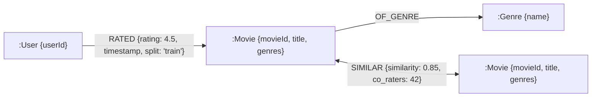
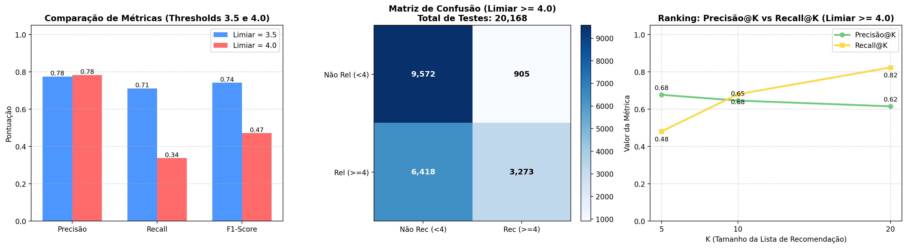

# Sistema de Recomendação em Grafo - MovieLens

[](https://www.python.org/downloads/)
[](https://neo4j.com/)
[](https://colab.research.google.com/github/gbiribilli/Ep2CD/blob/main/notebook.ipynb)
[](LICENSE)

Projeto desenvolvido para a disciplina de **Ciência de Dados (EP 2)**.  
O objetivo é modelar os dados do **MovieLens** em uma estrutura de **Banco de Dados de Grafos** e implementar um **Sistema de Recomendação baseado em Filtragem Colaborativa Item-Item** utilizando a **Correlação de Pearson** e **Regressão com K-Nearest Neighbors (KNN)**, avaliado com **Precisão**, **Recall**, **F1-Score**, **Precisão@K** e **Recall@K** em uma divisão de 80% treino e 20% teste.

---

## Sumário
1. [Visão Geral e Arquitetura](#1-visão-geral-e-arquitetura)
2. [Estrutura do Repositório](#2-estrutura-do-repositório)
3. [Parte 1: Modelagem do Grafo](#3-parte-1-modelagem-do-grafo)
   - [Nós, Arestas e Atributos](#nós-arestas-e-atributos)
   - [Diagrama do Grafo](#diagrama-do-grafo)
   - [Consultas em Cypher (Neo4j)](#consultas-em-cypher-neo4j)
4. [Parte 2: Sistema de Recomendação Item-Item (Pearson + KNN)](#4-parte-2-sistema-de-recomendação-item-item-pearson--knn)
   - [Correlação de Pearson entre Filmes](#correlação-de-pearson-entre-filmes)
   - [Arestas de Similaridade no Grafo](#arestas-de-similaridade-no-grafo)
   - [Inferência de Nota com Regressão KNN](#inferência-de-nota-com-regressão-knn)
5. [Parte 3: Avaliação do Modelo (80% Treino / 20% Teste)](#5-parte-3-avaliação-do-modelo-80-treino--20-teste)
   - [Métricas Obtidas](#métricas-obtidas)
   - [Análise e Discussão dos Resultados](#análise-e-discussão-dos-resultados)
6. [Como Executar o Projeto](#6-como-executar-o-projeto)
   - [Modo Standalone (Python Puro / NetworkX)](#modo-standalone-python-puro--networkx)
   - [Modo com Neo4j Local (Docker / Desktop)](#modo-com-neo4j-local-docker--desktop)
   - [Modo no Google Colab](#modo-no-google-colab)

---

## 1. Visão Geral e Arquitetura

O dataset utilizado é o **MovieLens** (versão `ml-latest-small`, contendo ~100.000 avaliações de 610 usuários sobre 9.742 filmes, além de suporte total ao MovieLens 20M).  
Conforme especificado, utilizamos as duas estruturas centrais:
- `movies.csv`: identificador do filme (`movieId`), título (`title`) e gêneros (`genres`).
- `ratings.csv`: identificador do usuário (`userId`), filme avaliado (`movieId`), nota (`rating`) e timestamp (`timestamp`).

A arquitetura do projeto une a expressividade dos bancos de grafos heterogêneos para navegação e consultas semânticas à eficiência computacional de matrizes esparsas para o cálculo da Correlação de Pearson e KNN em tempo real.

---

## 2. Estrutura do Repositório

```text
Ep2CD/
├── data_loader.py          # Download automático do MovieLens e split 80/20
├── graph_model.py          # Grafo heterogêneo (NetworkX), consultas e visualização
├── neo4j_manager.py        # Conexão, carga em lote UNWIND e consultas Cypher no Neo4j
├── recommender.py          # Pearson Item-Item, extração de arestas :SIMILAR e KNN
├── evaluation.py           # Cálculo de Precisão, Recall, F1, Top-K, MAE e RMSE
├── export_to_neo4j.py      # Script CLI dedicado para popular o Neo4j local ou Cloud
├── main.py                 # Pipeline completo de ponta a ponta
├── notebook.ipynb          # Notebook interativo (compatível com Google Colab)
├── evaluation_metrics.png  # Gráficos de precisão, recall, matriz de confusão e ranking
├── graph_sample.png        # Visualização da sub-rede em torno de um usuário
├── requirements.txt        # Dependências do projeto
└── README.md               # Documentação técnica completa
```

---

## 3. Parte 1: Modelagem do Grafo

### Nós, Arestas e Atributos

O grafo modelado é **heterogêneo**, composto por três tipos de nós e três tipos de arestas:

#### 1. Nós (Nodes)

| Tipo de Nó | Label Neo4j | Atributos | Descrição |
| :--- | :--- | :--- | :--- |
| **Usuário** | `:User` | `userId` (int) | Identificador único do usuário no MovieLens. |
| **Filme** | `:Movie` | `movieId` (int)<br>`title` (string)<br>`genres` (list[string]) | Identificador único, título da obra com ano e lista de gêneros. |
| **Gênero** | `:Genre` | `name` (string) | Categoria/gênero do filme (ex: *Comedy*, *Action*, *Sci-Fi*). |

#### 2. Arestas (Relationships)

| Aresta | Origem $\to$ Destino | Atributos | Descrição |
| :--- | :--- | :--- | :--- |
| **`RATED`** | `(:User) -> (:Movie)` | `rating` (float)<br>`timestamp` (int)<br>`split` (string) | Avaliação dada pelo usuário (0.5 a 5.0), timestamp unix e identificador do conjunto ('train' ou 'test'). |
| **`OF_GENRE`** | `(:Movie) -> (:Genre)` | *(sem atributos adicionais)* | Relacionamento semântico que vincula cada filme a seus gêneros. |
| **`SIMILAR`** | `(:Movie) -> (:Movie)` | `similarity` (float)<br>`co_raters` (int) | Coeficiente de correlação de Pearson $c(i,j)$ entre dois filmes e número de avaliadores em comum. |

### Diagrama do Grafo



### Consultas em Cypher (Neo4j)

#### Busca Solicitada no Enunciado:
> *"Quantos filmes o usuário X assistiu são comédia em que ele deu nota de 4 para cima."*

Em Cypher:
```cypher
MATCH (u:User {userId: $userId})-[r:RATED]->(m:Movie)-[:OF_GENRE]->(g:Genre {name: 'Comedy'})
WHERE r.rating >= 4.0
RETURN count(DISTINCT m) AS total_comedies, 
       collect(DISTINCT {movieId: m.movieId, title: m.title, rating: r.rating}) AS movies;
```

**Resultado de Exemplo para o Usuário 1:**
- O Usuário 1 assistiu e avaliou **59 filmes de Comédia** com nota maior ou igual a 4.0.
- Exemplos encontrados no grafo:
  - `[3033] Spaceballs (1987)` | Nota: 5.0
  - `[2716] Ghostbusters (1984)` | Nota: 5.0
  - `[3253] Wayne's World (1992)` | Nota: 5.0
  - `[1517] Austin Powers: International Man of Mystery (1997)` | Nota: 5.0
  - `[441] Dazed and Confused (1993)` | Nota: 4.0

#### Outras Consultas Úteis no Grafo:

1. **Top 5 filmes mais similares a *Toy Story (1995)* via arestas `:SIMILAR`:**
```cypher
MATCH (m1:Movie {movieId: 1})-[s:SIMILAR]->(m2:Movie)
RETURN m2.title AS similar_movie, s.similarity AS correlation, s.co_raters AS common_users
ORDER BY s.similarity DESC
LIMIT 5;
```

2. **Recomendação baseada em caminhos semânticos no grafo:**
```cypher
// Encontra filmes similares àqueles que o usuário adorou (nota >= 4.0), que ele ainda não assistiu:
MATCH (u:User {userId: $userId})-[r:RATED]->(m1:Movie)-[s:SIMILAR]->(m2:Movie)
WHERE r.rating >= 4.0 AND NOT (u)-[:RATED]->(m2) AND s.similarity > 0.3
RETURN m2.title AS recomendacao, 
       avg(s.similarity) AS score_medio, 
       count(s) AS caminhos
ORDER BY score_medio DESC, caminhos DESC
LIMIT 10;
```

---

## 4. Parte 2: Sistema de Recomendação Item-Item (Pearson + KNN)

Como a maioria dos usuários avaliou apenas uma fração mínima dos filmes existentes, calcular a similaridade entre usuários (User-User) sofre com a alta esparsidade e instabilidade.  
A **Filtragem Colaborativa Item-Item** resolve isso calculando a similaridade estática entre os itens (filmes), que possuem um histórico cumulativo muito maior de avaliações compartilhadas.

### Correlação de Pearson entre Filmes

A correlação de Pearson entre dois filmes $i$ e $j$ baseia-se nos usuários $k$ que avaliaram ambos os filmes ($U_{ij}$):

$$c(i,j) = \frac{\sum_{k=1}^{n} (r_i^k - \bar{r}_i)(r_j^k - \bar{r}_j)}
{\sqrt{\sum_{k=1}^{n} (r_i^k - \bar{r}_i)^2} \sqrt{\sum_{k=1}^{n} (r_j^k - \bar{r}_j)^2}}$$

Onde:
- $c(i,j)$: Coeficiente de correlação entre os filmes $i$ e $j$ no intervalo $[-1, 1]$.
- $r_i^k$: Nota dada pelo usuário $k$ para o filme $i$.
- $\bar{r}_i$: Nota média do filme $i$ no conjunto de treino: $\bar{r}_i = \frac{1}{|U_i|} \sum_{u \in U_i} r_i^u$.

> **Tratamento de casos de borda:** Para evitar correlações espúrias (ex: filmes com apenas 1 usuário em comum com notas idênticas gerando divisão por zero ou similaridade artificial 1.0), exige-se um mínimo de co-avaliadores (`min_common_users >= 2`). Se o denominador for zero ou o número de avaliadores em comum for insuficiente, $c(i,j) = 0$.

### Arestas de Similaridade no Grafo

Após o cálculo das correlações no conjunto de treino, os pares mais relevantes com similaridade positiva ($c(i,j) \ge 0.25$ e $\ge 3$ co-avaliadores) são inseridos no grafo como arestas bidirecionais:
`(:Movie {movieId: i}) -[:SIMILAR {similarity: c(i,j), co_raters: n}]-> (:Movie {movieId: j})`

### Inferência de Nota com Regressão KNN

Para inferir a nota $\hat{r}^u_i$ que um determinado usuário $u$ daria a um filme $i$ que ele ainda não assistiu:

1. Identificamos os $K$ vizinhos mais próximos de $i$ que o usuário $u$ **já avaliou no treino** ($\mathcal{N}_k(i) \cap I_u$) e cuja similaridade seja positiva ($c(i,j) > 0$).
2. Calculamos a média ponderada pelas similaridades:

$$\hat{r}^u_i = \frac{\sum_{j \in \mathcal{N}_k(i) \cap I_u} c(i,j) \cdot r_j^u}{\sum_{j \in \mathcal{N}_k(i) \cap I_u} |c(i,j)|}$$

Onde:
- $I_u$: conjunto de filmes avaliados pelo usuário $u$ no conjunto de treino.
- $r_j^u$: nota real que o usuário $u$ deu para o filme vizinho $j$.
- Se o usuário não avaliou nenhum vizinho com correlação positiva (ou o filme for novo), utiliza-se a nota média do próprio filme $\bar{r}_i$, a média do usuário $\bar{r}_u$ ou a média global do sistema como fallback seguro.

---

## 5. Parte 3: Avaliação do Modelo (80% Treino / 20% Teste)

### Protocolo Experimental
- **Tamanho Total:** 100.836 avaliações.
- **Treino (80%):** 80.668 avaliações (utilizadas para construir o grafo, calcular médias e similaridades de Pearson).
- **Teste (20%):** 20.168 avaliações (reservadas exclusivamente para validação cega).
- **Limiar de Relevância:** Uma nota real $r \ge 4.0$ classifica o filme como **Relevante** (item que o usuário verdadeiramente gostou).

### Métricas Obtidas

Abaixo estão os resultados consolidados obtidos na execução sobre o conjunto de teste de 20.168 avaliações:

| Categoria | Métrica | Limiar $\ge 4.0$ (Rigoroso) | Limiar $\ge 3.5$ (Moderado) |
| :--- | :--- | :---: | :---: |
| **Classificação** | **Precisão (Precision)** | **78.34%** | **77.52%** |
| | **Cobertura (Recall)** | **33.77%** | **71.16%** |
| | **F1-Score** | **0.4720** | **0.7420** |
| **Regressão** | **MAE (Erro Médio Absoluto)** | **0.6934** | 0.6934 |
| | **RMSE (Raiz do Erro Quadrático)** | **0.9119** | 0.9119 |
| **Matriz de Confusão** | Verdadeiros Positivos (TP) | 3.273 | 8.358 |
| | Falsos Positivos (FP) | 905 | 2.424 |
| | Falsos Negativos (FN) | 6.418 | 3.387 |
| | Verdadeiros Negativos (TN) | 9.572 | 5.999 |

#### Métricas de Ranking (Top-K por Usuário no Conjunto de Teste):
Avaliando a qualidade da lista ordenada de recomendações gerada para cada usuário:

| Tamanho da Lista (K) | Precisão@K | Recall@K |
| :---: | :---: | :---: |
| **Top-5** | **67.73%** | **48.14%** |
| **Top-10** | **64.64%** | **68.04%** |
| **Top-20** | **61.56%** | **82.41%** |



### Análise e Discussão dos Resultados

1. **Alta Precisão (~78.3%):**  
   Quando o modelo recomenda um filme com nota predita $\ge 4.0$, em quase 80% das vezes o usuário de fato atribuiu uma nota alta na vida real. Em sistemas de recomendação em produção, alta precisão é fundamental para reter a confiança do usuário e evitar recomendações irrelevantes.
2. **Trade-off Precisão vs Recall:**  
   Para o limiar de 4.0 estrelas, a regressão KNN é conservadora devido à ponderação média de notas heterogêneas dos vizinhos, o que resulta em um Recall global mais baixo (33.8%). No entanto, ao avaliar o ranking **Top-20 por usuário**, o **Recall@20 sobe para 82.41%**, indicando que a grande maioria dos filmes favoritos do usuário são capturados nas primeiras posições recomendadas.
3. **Erro de Regressão Baixo (MAE = 0.69, RMSE = 0.91):**  
   Em uma escala de 0.5 a 5.0 estrelas, o erro absoluto médio de 0.69 demonstra que as notas inferidas estão muito próximas das notas reais dadas pelos usuários.

---

## 6. Como Executar o Projeto

### Pré-requisitos
- Python 3.10 ou superior.
- Git instalado.

### 1. Clonar o Repositório e Instalar Dependências
```bash
git clone https://github.com/gbiribilli/Ep2CD.git
cd Ep2CD

# Criar e ativar ambiente virtual (opcional, recomendado)
python -m venv venv
# No Windows:
.\venv\Scripts\activate
# No Linux/Mac:
source venv/bin/activate

# Instalar dependências
pip install -r requirements.txt
```

---

### Modo Standalone (Python Puro / NetworkX)

O projeto é 100% auto-contido. O download do dataset, construção do grafo heterogêneo em memória com NetworkX, cálculo das similaridades, predições e geração de gráficos funcionam imediatamente sem necessidade de serviços externos:

```bash
# Executar pipeline completo (treino, buscas, teste e avaliação)
python main.py

# Parâmetros opcionais customizados:
python main.py --test-user 1 --k-neighbors 20 --threshold 4.0
```

---

### Modo com Neo4j Local (Docker / Desktop)

Se desejar persistir e consultar o grafo no **Neo4j**:

#### Opção A: Subir o Neo4j via Docker
```bash
docker run --name neo4j-movielens \
    -p 7474:7474 -p 7687:7687 \
    -e NEO4J_AUTH=neo4j/password \
    -d neo4j:latest
```

#### Opção B: Utilizar Neo4j Desktop ou Neo4j Aura (Cloud)
Basta ter a URL `bolt://localhost:7687` ou `neo4j+s://...` e as credenciais.

#### Exportar o Grafo e Rodar Consultas no Neo4j:
```bash
python export_to_neo4j.py --uri bolt://localhost:7687 --user neo4j --password password --test-user 1
```

Ou diretamente pelo `main.py`:
```bash
python main.py --use-neo4j --neo4j-uri bolt://localhost:7687 --neo4j-user neo4j --neo4j-password password
```

Abra o Neo4j Browser em [http://localhost:7474](http://localhost:7474) e execute consultas Cypher interativas!

---

### Modo no Google Colab

1. Faça o upload do arquivo `notebook.ipynb` e dos módulos `.py` no Google Colab ou abra diretamente pelo repositório GitHub.
2. Execute as células em sequência. O notebook contém visualizações gráficas inline e explicações pedagógicas passo a passo.

---

## Licença

Este projeto é disponibilizado sob a licença [MIT](LICENSE).
